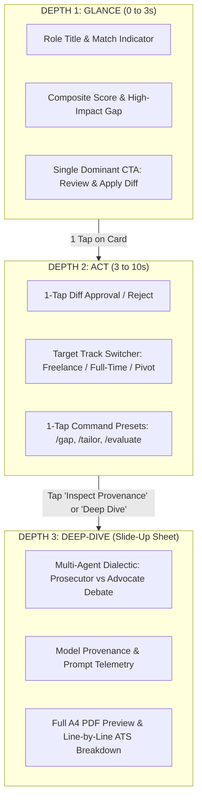

# CareerOS Experience Charter & Cognitive Architecture

## 1. Executive Summary & Vision

CareerOS is an elite AI Career Strategy engine and autonomous job intelligence workspace. It bridges the chasm between raw candidate experience and the reality of modern hiring algorithms, recruiter psychology, and compensation leverage.

This charter establishes the human-centric cognitive architecture, design system contracts, perceptual guardrails, and usability budgets that govern every interface, component, and interaction within CareerOS.

---

## 2. Core Experience Foundation (Phase 0 Diagnostic Realities)

### The Wedge & Core Job-to-be-Done (JTBD)
- **Primary Wedge**: **Instant JD-to-Resume Gap Score + 1-Click Diff Fix (< 15 seconds)**.
- **Value Delivery**: Within 10 seconds of landing, the candidate receives an objective, unvarnished match score against their target mandate with actionable, 1-click bullet upgrades using the Google XYZ formula ($\text{Accomplished [X]} \text{ as measured by [Y]} \text{ by doing [Z]}$).

### The Anchor Paradigm
- **Intent-Driven Generative Stream**: The primary workspace is anchored by a conversational prompt deck that generates **stateful, morphing interactive cards** governed by 3-depth progressive disclosure. It eliminates static dashboards, endless dead-end menus, and sprawling forms.

### The "3 Feeling Words"
Every interaction, micro-copy string, and visual state must evoke:
1. **Surgically Prepared**: Unshakable confidence that candidate bullets and positioning withstand recruiter scrutiny and ATS parsing.
2. **Confident**: Total clarity on value levers, compensation leverage, and mandate trade-offs.
3. **Unburdened**: Cognitive ease through radical reduction of friction, zero paperwork overhead, and $\le 2$ taps to execute any critical action.

### Anti-Goals (Categorically Blocked Architecture)
- ❌ **No Generic Cover Letter Spam**: We refuse to build generic LLM text-fillers or multi-page questionnaire fluff.
- ❌ **No Unsegmented Monoliths**: We refuse to dump 5+ metric dashboards, pipeline tables, and forms into a single endless vertical scroll.
- ❌ **No Raw Markdown AI Dumps**: When an action is possible, the AI outputs structured, interactive cards with smart defaults rather than walls of text.
- ❌ **No Viewport Action Overload (Hick-Hyman Law)**: Never present more than 3 options or 1 primary CTA per viewport.

---

## 3. The 3-Depth Progressive Disclosure Model

### Depth 1: Glance (0 to 3 Seconds)
- What the user sees without touching the screen.
- Restricted to:
  1. *Context Eyebrow*: Track indicator (e.g., `Freelance • €950/d`) and active status.
  2. *Hero Metric / Core State*: The composite score (e.g., `88/100 ATS Match`) formatted with `tabular-nums`.
  3. *Primary Action*: Exactly ONE high-contrast primary CTA button (e.g., `[Apply 3 Upgrades]`).

### Depth 2: Act (3 to 10 Seconds)
- High-velocity tactile micro-interactions:
  - 1-click bullet replacement toggles.
  - Binary forks for ambiguous attributes (Option A vs Option B).
  - Track-switching dropdown with immediate preset recalculation.

### Depth 3: Deep-Dive / Learn (Non-Blocking Slide-Up Sheet)
- Accessible, swipe-to-dismiss bottom/side drawer:
  - Multi-agent debate transcripts (Prosecutor vs Advocate).
  - Explainability & model provenance ("Why was this suggested?").
  - Full-screen headless A4 PDF preview.
  - **Rule**: Depth 3 details never contaminate Depth 1 glanceability.

---

## 4. Information Architecture & Navigation Schema

The application is structured into a streamlined 4-destination model. Every secondary state renders in non-blocking overlay sheets:

| Destination | Primary Role | Core Primitives Used |
| :--- | :--- | :--- |
| **1. Strategic Studio (Stream)** | Main conversational command center & generative card stream. | `<GenerativeCard>`, `<SurfaceCard>`, `<InteractiveCheckin>` |
| **2. Role Gap Studio** | Side-by-side JD analysis, match scoring, and bullet optimization. | `<SurfaceCard>`, `<TelemetryMetric>`, `<ProgressiveDrawer>` |
| **3. Mandate Pipeline** | Active pipeline, rate benchmarks, and status cards. | `<SurfaceCard>`, `<InteractiveCheckin>` |
| **4. Career Vault** | Master profile, verified skills, and compiled PDF artifacts. | `<TelemetryMetric>`, `<ProgressiveDrawer>` |

### Hidden Persona & Administrative Controls
- Per Phase 0 protocol: Developer telemetry, AI model switcher, `EnergyCreditBadge`, and the B2B Recruiter Portal are relocated away from the main viewport.
- Accessible via a hidden **5-tap gesture on the version label in the footer** (`CareerOS Super-Agent v2.0`).

---

## 5. Usability & Touch Budgets

| Metric | Target Specification | Enforcement Mechanism |
| :--- | :--- | :--- |
| **Core Loop Tap Budget** | $\le 2$ taps from landing to diff execution | Pre-filled smart defaults + 1-tap accept. |
| **Touch Target Dimensions** | $\ge 44 \times 44\text{px}$ on all interactive elements | Apple HIG & WCAG 2.2 SC 2.5.8 compliance. |
| **Touch Separation** | $\ge 8\text{px}$ minimum margin between hit targets | Layout spacing tokens. |
| **Thumb-Zone Placement** | High-frequency actions in bottom 40% of viewport | Floating bottom action deck with `pb-safe`. |
| **Keyboard Accessibility** | Full navigation via `Tab`, `Enter`, and `Cmd+K` / `/` | Focus rings with 2px offset + explicit ARIA. |

---

## 6. Visual Balance & Token Rules (60-30-10)

- **60% Neutral Surface**: Obsidian / deep slate canvas (`#090D14`, `#0F172A`) or clean architectural paper (`#F8FAFC`).
- **30% Structural Contrast**: Elevated cards (`bg-white` or `bg-slate-900/60`), subtle borders (`border-slate-200` or `border-slate-800`), muted typography (`text-slate-500` or `text-slate-400`).
- **10% Purposeful Accent**: High-contrast Indigo/Cyan (`#4F46E5`, `#06B6D4`) and Emerald (`#10B981`) reserved strictly for active states, generative progress bars, and the single primary CTA.
