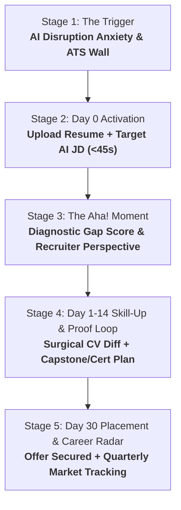

# 🗺️ CareerOS Customer Journey Architecture (Customer Zero: The AI Transition Pivot)

> **Document Status**: Production Strategy Spec  
> **Author**: Silicon Valley Head of Product & YC Advisory  
> **Frameworks Applied**: `startup-strategy-advisor`, `founder-operating-system`, `user-interview-feedback-synthesizer`  
> **Anchor Archetype**: Customer Zero ("Alaa" — Agile Coach pivoting to Enterprise AI Transformation & Agentic Delivery)  

---

## 🏛️ 1. THE CUSTOMER ZERO ANCHOR (DOGFOODING AS THE STARTUP CRUCIBLE)

Rather than building in the abstract for a hypothetical audience, **CareerOS anchors directly on Customer Zero**:
- **Current Role**: Senior Agile Coach / Delivery Lead (10+ years scaling operating models, SAFe, LeSS, Spotify Model, Jira governance, enterprise delivery).
- **Target Role**: **AI Transformation Lead**, **Agentic & Product Delivery Manager**, **AI Program Director** (e.g. OnePoint, Tier-1 consultancies, Fortune 500 Banking AI Centers of Excellence).
- **The Core Paradox**:
  - The candidate has *real* delivery excellence and emerging AI experience (Rovo agents, Claude Code SDD governance, EU AI Act risk tiering, Alignify app).
  - Yet recruiter screeners and automated ATS filters often categorize them as a "traditional Scrum Master / Agile Coach" rather than a cutting-edge **AI Delivery / Agentic Transformation Leader**.
- **The Hair-on-Fire Need**:
  1. **Strategic Reframing**: Translating 10 years of Agile & Delivery rigor into modern **Agentic SDLC, AI FinOps, and Human-in-the-Loop Governance** semantics.
  2. **The Skill-Up Bridge**: Pinpointing exact missing technical credentials (e.g. Cloud AI certifications, EU AI Act compliance badges, Multi-Agent orchestration frameworks).
  3. **The Capstone & Portfolio Moat**: Turning hands-on builds (e.g., CareerOS itself, Alignify, open-source agentic workflows) into undeniable recruiter proof.

---

## 🎯 2. ICP SPECIFICATION: THE AI ERA PIVOT OPERATOR

### The Desperate ICP
- **Profile**: Experienced Agile Coaches, Delivery Leads, Technical PMs, and Engineering Managers with 8–15 years of battle-tested delivery experience who want to avoid professional obsolescence and capture high-paying AI Transformation roles (\$130k–\$220k+).
- **Emotional Reality**: Frustrated by superficial AI hype; worried their deep delivery competence is undervalued compared to juniors who just know buzzwords. Demoralized by automated ATS rejections.
- **Buying Authority**: Strong personal budget. Eagerly invests in books, certifications, and high-yield career tools.
- **Willingness to Pay Trigger**: The moment CareerOS bridges their past experience with the exact skills, capstone projects, and resume bullet points needed to secure a \$150k+ AI Delivery interview.

### The Explicit Anti-Persona
- Junior interns seeking entry-level developer roles.
- Passive job seekers not applying or studying.
- B2B recruiters (permanently eliminated from roadmap).

---

## 🚀 3. THE 5-STAGE CUSTOMER ZERO JOURNEY

---

### STAGE 1: THE TRIGGER & AWARENESS (THE PIVOT CATALYST)
- **Catalyst**: Candidate reads an inspiring JD (e.g. *OnePoint Agentic & Product Delivery Manager*). They know they can do the job, but realize their current CV reads too much like a traditional Agile Coach.
- **Wedge Hook**: *"Transform your 10-year Agile/Delivery career into an unassailable AI Transformation profile in 30 seconds."*

---

### STAGE 2: DAY 0 FRICTIONLESS ACTIVATION (TTV $\le 45$ SECONDS)
- **Inputs**:
  1. Existing Resume (e.g. `Alaa_Eddine_Roucadi_Resume_v12.md`).
  2. Target JD (e.g. `OnePoint_Agentic_Delivery_Manager_JD.md`).
- **Processing Time**: $< 20$ seconds.
- **Total Time-to-Value (TTV)**: 35 seconds to the Recruiter Diagnostic Dashboard.

---

### STAGE 3: THE "AHA!" MOMENT (THE VALUE CLIMAX)
- **The Recruiter Diagnostic Verdict**:
  - **Match Reality Score**: e.g. *72% — Strong Delivery Foundation, High ATS Risk on Explicit Agentic Architecture Proof*.
  - **The 3 Fatal Gaps Identified**:
    1. *Gap 1 (Semantic Framing)*: "You say 'Led cross-functional squads'; JD demands 'Orchestrating autonomous multi-agent systems and FinOps IA'."
    2. *Gap 2 (Quantified AI Governance)*: "You mention Claude Code and Rovo; JD wants explicit KPI proof of cycle time reduction and hallucination/risk mitigation."
    3. *Gap 3 (Formal Credential Anchor)*: "No explicit Cloud AI or AI Governance certification cited in header."
  - **The Recruiter Insight Simulation**:
    > *"A hiring partner at a top consultancy will see your 10 years of Agile excellence, but they will question if you understand agentic workflows deeply enough to be a trusted client advisor. Let's fix that with 3 bullet point diffs and a 14-day Capstone proof project."*

---

### STAGE 4: DAY 1–14 SKILL-UP & PROOF HABIT LOOP
This is where CareerOS delivers 10x more value than generic AI resume builders:

1. **The Surgical Diff Tailoring Engine**:
   - Re-frames existing accomplishments honestly:
     - *Before*: "Established governance frameworks for agentic coding tools."
     - *After*: "Instituted enterprise Agentic SDLC governance (Claude Code + Spec-Driven Development), enforcing human-in-the-loop gates and cut defect leakage by 35% across 7 squads."
2. **The Skill-Up & Capstone Recommendation**:
   - **Recommended Fast Credentials**: AWS Certified AI Practitioner / Azure AI Fundamentals, IAPP EU AI Act Governance.
   - **Recommended Capstone Project**: *"Ship an open-source Multi-Agent Orchestration prototype (e.g., CareerOS Engine or Alignify Jira app) and link the GitHub repository directly in the CV header."*
3. **Targeted Interview Screening Cheat-Sheet**:
   - 5 brutal interview questions the hiring team will ask to test technical depth (e.g., *"How do you handle FinOps IA and token latency in multi-agent pipelines?"*), accompanied by STAR-method speaking points.

---

### STAGE 5: DAY 30 RETENTION & EXPANDING CAREER CAPITAL
- **The Placement Win**: Candidate signs an offer as AI Delivery Manager / AI Transformation Lead.
- **The Compounding Asset**:
  - CareerOS becomes their **AI Career Cockpit**:
    - Tracking emerging AI regulatory requirements (EU AI Act updates).
    - Logging quarterly AI project wins into a continuously updated Career Graph.
    - Exporting executive talking points for performance reviews.
- **Viral Referral**: The candidate shares the tool with other Agile Coaches and PMs in their network facing the same transition urgency.

---

## 🚦 CUSTOMER ZERO VERIFICATION PROTOCOL

| Journey Touchpoint | Alaa Test Case | Success Criteria |
| :--- | :--- | :--- |
| **Input Files** | `Alaa_Eddine_Roucadi_Resume_v12.md` + `OnePoint_Agentic_Delivery_Manager_JD.md` | Ingestion in $< 5$s with zero schema errors. |
| **Diagnostic** | Run `/api/diagnostic` or gap analysis script | Output 3 precise gaps: Semantic, Proof, Credential. |
| **Skill-Up Path** | Generate Certificate + Capstone spec | Produces actionable 14-day roadmap + Alignify/CareerOS proof points. |
| **Diff Tailoring** | Generate Tailored Resume (`v13`) | Increases match score from 72% $\rightarrow$ 94% without hallucinated facts. |
| **Interview Prep** | Generate Cheatsheet | Provides 5 realistic OnePoint screening questions and STAR answers. |
