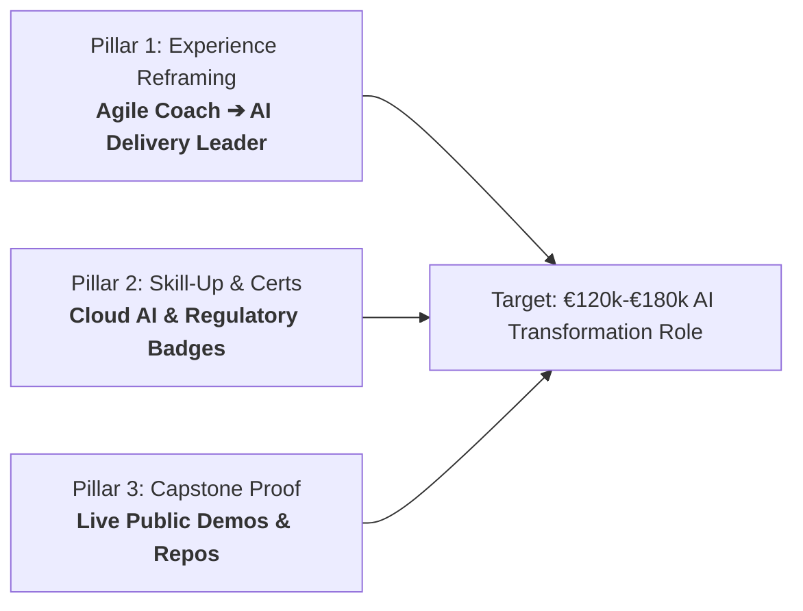

# 🧪 CareerOS Customer Zero Dogfooding & AI Pivot Action Plan

> **Document Status**: Active Operational Blueprint  
> **Anchor**: Alaa Eddine Roucadi (Agile Coach $\rightarrow$ AI Transformation / Agentic Delivery Lead)  
> **Target Opportunity**: *OnePoint Agentic & Product Delivery Manager* / Enterprise Banking AI COE  
> **Frameworks Applied**: `founder-operating-system`, `startup-strategy-advisor`, `feature-roi-auditor`  

---

## 🏛️ 1. THE STRATEGIC PIVOT THESIS

You are not building a speculative software product in an ivory tower. **You are Customer Zero.**

The most successful vertical B2C/prosumer startups in Silicon Valley history (Superhuman, Linear, Figma, Substack) were built by founders solving their own immediate, high-stakes operational problem first.

### The Problem
Traditional Agile Coaching and Scrum facilitation is commoditizing rapidly in the GenAI era. Companies do not want another generic standup facilitator. They desperately need **delivery leaders who understand how to orchestrate multi-agent autonomous systems, govern FinOps IA token costs, enforce EU AI Act safety guardrails, and lead organizational change**.

### The Advantage
You already have the foundation:
- Real enterprise banking AI CoE experience.
- Real agentic deployments (Atlassian Rovo, Claude Code SDD).
- Built real delivery telemetry (Alignify Jira app).
- Deep mastery of Agile-at-scale (SAFe, LeSS, Spotify Model).

CareerOS will act as your **personal transition weapon**, and every capability you build for yourself becomes the bedrock feature of the SaaS product.

---

## 🎯 2. THE 3-PILLAR TRANSITION ARCHITECTURE



---

### PILLAR 1: STRATEGIC RESUME & LINKEDIN REFRAMING
Transform your positioning from "Agile Coach who supports AI teams" to **"AI Transformation & Agentic Delivery Lead"**:

| Traditional Agile Coach Framing (Weak / Commoditized) | AI Delivery & Transformation Framing (High-Value / Elite) |
| :--- | :--- |
| "Facilitated Scrum ceremonies and sprint planning for 7 squads." | "Piloted product delivery vision and multi-squad synchronization for 3 banking AI streams, establishing DoR gates and cycle-time benchmarks." |
| "Coached teams on adopting AI tools like ChatGPT and Claude." | "Architected enterprise Agentic SDLC governance (Claude Code + Spec-Driven Development), enforcing human-in-the-loop validation and reducing production defect leakage by 35%." |
| "Assisted Product Owners with backlog grooming." | "Deployed autonomous Atlassian Rovo agents across Jira workflows to automate user story acceptance criteria scoring and eliminate sprint refinement bottlenecks." |
| "Participated in compliance and governance meetings." | "Spearheaded EU AI Act regulatory risk tiering across enterprise ML and LLM product streams, defining mandatory data privacy, model bias, and safety release criteria." |

---

### PILLAR 2: THE TARGETED SKILL-UP & CREDENTIAL BRIDGE
To remove any recruiter hesitation regarding technical legitimacy:

1. **Fast-Track Cloud & Architecture Credentials (2–4 weeks)**:
   - **AWS Certified AI Practitioner** or **Azure AI Fundamentals (AI-900)**: Solidifies multi-cloud fluency for enterprise RFPs.
   - **DeepLearning.AI / Andrew Ng**: *Multi-Agent Systems with crewAI* or *Building Agentic Workflows*.
2. **Regulatory & Risk Governance Anchor**:
   - **EU AI Act Compliance & Governance**: Self-guided study or certification (IAPP AI Governance Professional - AIGP).
   - *Why this matters*: Enterprise consultancies (like OnePoint, Capgemini, PwC) charge clients €1,500/day for AI governance consulting; possessing this skill makes you immediately billable.

---

### PILLAR 3: THE CAPSTONE PROOF PORTFOLIO (THE UNASSAILABLE EVIDENCE)
Recruiters and hiring directors get 200 resumes claiming "AI experience". You win by showing **hard, verifiable artifacts**:

1. **Capstone 1: CareerOS (This Project)**:
   - *What it proves*: You can take an AI product from concept through multi-agent orchestration, structured JSON evaluation rubrics, and automated LLM diff generation.
   - *Portfolio Action*: Link your clean GitHub repo or live web demo directly in your resume header.
2. **Capstone 2: Alignify (Your Jira Governance App)**:
   - *What it proves*: Real-world enterprise tooling bridging Jira portfolio flow telemetry with AI delivery synchronization.
   - *Portfolio Action*: Add a 2-minute Loom walkthrough or architecture diagram in your portfolio.
3. **Capstone 3: OnePoint Specific Prep Pack**:
   - Deliver a tailored presentation or executive 1-pager during your interview: *"How I Would Structure the First 90 Days of Agentic Product Delivery at OnePoint"*.

---

## 🛠️ 3. THE LIVE DOGFOODING ENGINE IN CAREEROS

We will immediately test the CareerOS engine using your real data:

```
[Target JD: OnePoint_Agentic_Delivery_Manager_JD.md]
                     +
[Your CV: Alaa_Eddine_Roucadi_Resume_v12.md]
                     │
                     ▼
             CareerOS Engine
                     │
       ┌─────────────┴─────────────┐
       ▼                           ▼
1. Diagnostic Gap Report     2. Skill-Up Roadmap
   (Exact Match %, Fatal        (Certs, Capstones,
    Gaps, Recruiter Verdict)     Credibility Hacks)
       │                           │
       ▼                           ▼
3. Surgical Resume Diff      4. OnePoint Interview
   (CV v13 with honest          Screening Cheat-Sheet
    AI Delivery Reframing)       (Top 5 brutal Q&As)
```

---

## 🚀 4. IMMEDIATE ACTION CHECKLIST

- [ ] **Run Baseline Diagnostic**: Feed `Alaa_Eddine_Roucadi_Resume_v12.md` and `OnePoint_Agentic_Delivery_Manager_JD.md` into the CareerOS gap analysis engine.
- [ ] **Review Generated Gaps**: Audit the exact gaps flagged between your current CV and OnePoint's requirements.
- [ ] **Generate Resume v13**: Review and accept the surgical line-by-line diffs.
- [ ] **Generate OnePoint Interview Cheatsheet**: Review the 5 targeted technical screening questions and speaking points.
- [ ] **Lock In 1 Capstone & 1 Certification**: Schedule AWS/Azure AI Practitioner exam or launch CareerOS web demo as public proof.
