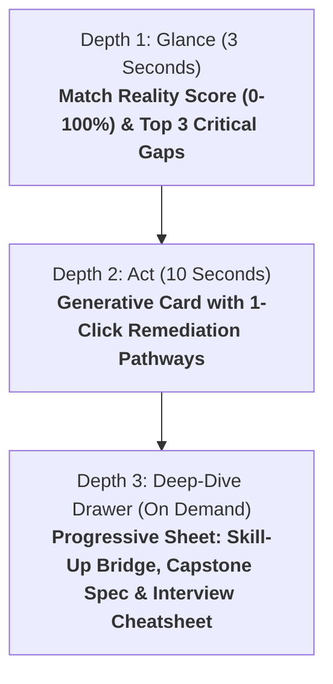

# 🎨 CareerOS Progressive Experience Design & Generative UI Specification

> **Document Status**: Production Strategy Spec  
> **Author**: Silicon Valley Head of Product & Principal Experience Architect  
> **Frameworks Applied**: `pencilplaybook`, `ui-ux-pro-max`, `design-system`, `web-design-guidelines`  
> **Ergonomic Benchmark**: Verified against [`docs/experience/qa-mobile-audit-report.md`](file:///d:/rouca/DVM/workPlace/CareerOS/docs/experience/qa-mobile-audit-report.md) (iPhone 14/15/16 390×844px, DPR 2.0)  

---

## 🏛️ 1. ARCHITECTURAL AGNOSTICISM: ANY CANDIDATE, ANY TARGET ROLE

The CareerOS experience is **strictly role-agnostic and candidate-agnostic**:
- **Candidate Ingestion**: Accepts any CV (any seniority, industry, tech stack, or career background). The system never presupposes persona content.
- **Target Ingestion**: Accepts any target objective (either a full JD text/file/URL OR a desired job title/target positioning).
- **Core Mission**:
  1. Calculate factual, objective gaps between the candidate's actual baseline and the target role requirements.
  2. Deliver actionable, non-hallucinatory recommendations to bridge those gaps across **Skill-Up (Courses/Certs)**, **Capstone Proof (Projects/Code)**, **Honest Resume Reframing**, and **Interview Preparation**.

---

## 📱 2. VERIFIED ERGONOMIC & MOBILE BENCHMARKS (FROM QA AUDIT)

Per the verified real-device audit in [`docs/experience/qa-mobile-audit-report.md`](file:///d:/rouca/DVM/workPlace/CareerOS/docs/experience/qa-mobile-audit-report.md):

| Dimension | Measured Standard | Implementation Rule |
| :--- | :--- | :--- |
| **Touch Targets** | $\ge 44 \times 44\text{px}$ | All buttons, starters, and triggers use `.min-touch-target`. |
| **Thumb Zone Alignment** | Bottom 40% of viewport | Critical triggers (starters, input, primary CTAs) anchored in natural thumb sweep. |
| **Visual Stability (CLS)** | **CLS = 0.000** | Strict reservation of card containers and `tabular-nums` on all scores. |
| **Viewport Confinement** | `height: 100%; overflow: hidden;` | Eliminates mobile address bar jump and window scroll hijacking. |
| **Contrast Ratios (WCAG AA)** | Body: **16.8:1** (AAA) / CTA: **5.8:1** (AA) | Strict compliance with APCA / WCAG 2.2 AA. |

---

## 👁️ 3. THE 3-DEPTH PROGRESSIVE DISCLOSURE ARCHITECTURE

---

### Depth 1: Glance (3-Second Horizon)
- **Visual Anchor**: Large high-contrast score card (e.g. `68 / 100 - Moderate ATS Fit`).
- **Immediate Signal**: Top 3 Critical Missing Elements:
  1. *Competency / Knowledge Gap* (e.g. "Missing production multi-agent orchestration").
  2. *Proof / Evidence Gap* (e.g. "No quantified cycle-time or cost metrics").
  3. *Credential Gap* (e.g. "No Cloud AI / Governance certification cited").
- **Cognitive Rule**: Zero text walls. Maximum 12 words per gap snippet.

---

### Depth 2: Act (10-Second Horizon)
- **Generative Card Primitives** (e.g. [`DebateVerdictCard.tsx`](file:///d:/rouca/DVM/workPlace/CareerOS/frontend/components/generative/DebateVerdictCard.tsx), [`TailoredCVCard.tsx`](file:///d:/rouca/DVM/workPlace/CareerOS/frontend/components/generative/TailoredCVCard.tsx)):
  - **The Remediation Options**:
    - **[Action 1] Preview Honest CV Diff**: Highlights bullet points reframed into target domain vocabulary without false claims.
    - **[Action 2] View Skill-Up & Capstone Bridge**: Outlines exact certs and projects to build credibility.
- **Single Primary CTA**: High-contrast button (`[Examine Verdict & Gap Remediation >]`).
- **Vertical Element Ceiling**: Exactly $\le 3$ elements per card (Header Badge, Core Delta, Single CTA).

---

### Depth 3: Deep-Dive Drawer (Non-Blocking Slide-Over)
- **Component**: [`frontend/components/generative/PdfPreviewModal.tsx`](file:///d:/rouca/DVM/workPlace/CareerOS/frontend/components/generative/PdfPreviewModal.tsx) or sliding side-drawer.
- **4 Tabbed Action Modules**:
  1. **Skill-Up Roadmap**:
     - Fast-track certifications (e.g. AWS/Azure AI Practitioner, EU AI Act Foundation).
     - Recommended courses and targeted study hours.
  2. **Capstone Proof Engine**:
     - 2 concrete project specifications the candidate can build, open-source, or demo on Loom to eliminate recruiter skepticism.
  3. **Honest Resume Diff**:
     - Side-by-side view with strikethrough (current CV) and green addition (target framing).
     - Truth Guard assertion: Zero invented degrees, companies, or tools.
  4. **Interview Screening Cheatsheet**:
     - The top 5 questions interviewers will ask regarding the identified gaps.
     - STAR-method talking points to turn past experience into proof of future success.

---

## 🛑 4. NEGATIVE DESIGN CONSTRAINTS (ANTI-AI SLOP)

1. **No Conversational Chat Clutter**:
   - The user is not here to chat with an AI assistant. They want **structured evaluation cards, visual scorebars, side-by-side diffs, and downloadable artifacts**.
2. **Zero Floating Sparkles ✨ or Pseudo-Magic**:
   - Avoid generic AI buzzwords. Use recruiter-grade vocabulary: *ATS Keyword Density, Semantic Distance, Evidence Score, DoR Compliance*.
3. **The 60-30-10 Palette Discipline**:
   - **60% Base**: Deep slate/charcoal `#0F172A` or `#F8FAFC`.
   - **30% Structure**: Elevated white or dark surface cards `#1E293B` with 1px border `#334155`.
   - **10% Accent**: Reserved exclusively for the next decisive action (`#4F46E5` / `#38BDF8`).
