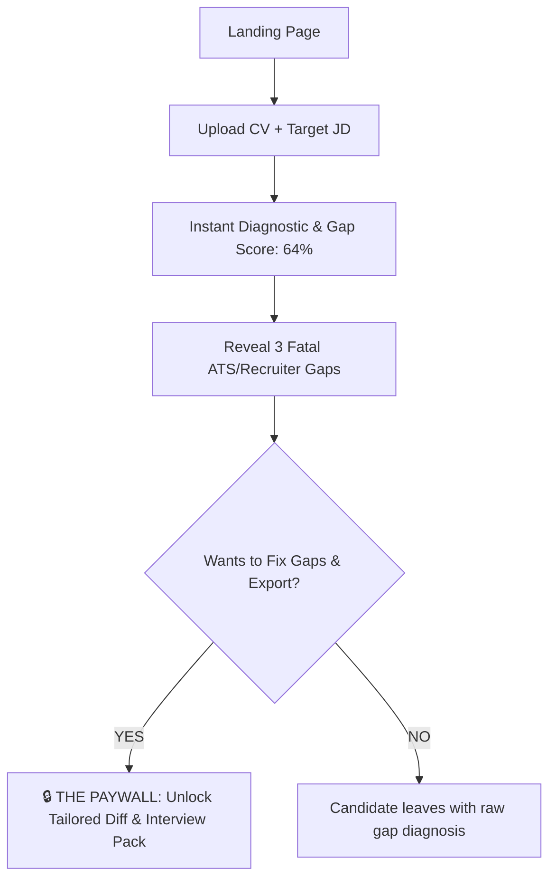

# 💳 CareerOS Monetization Architecture & Paywall Blueprint

> **Document Status**: Production Strategy Spec  
> **Author**: Silicon Valley Head of Product & YC Advisory  
> **Frameworks Applied**: `pricing-strategy-architect`, `build-vs-sell`  
> **Target Alignment**: YC W24 Monetization Mechanics  

---

## 🏛️ 1. THE CORE VALUE METRIC

### The Cardinal Rule
**Never charge for abstract engineering units (AI tokens, API calls, database rows).**  
Candidates do not care about tokens; they care about **passing ATS screeners and landing high-paying interview rounds**.

### The Value Metric: "Tailored Application Unlocks"
- **Value Unit**: The complete remediation cycle for a specific target job (Diagnostic → Gap Resolution Diff → Clean ATS-Proof Export → Custom Interview Cheat-Sheet).
- **Why this works**: Directly couples price with the candidate's career upside (a \$140k+ salary offer).

---

## 🎯 2. PAYWALL PLACEMENT & TIMING (IRREVERSIBLE VALUE REALIZATION)



### The Iron Rule of Paywall Placement
1. **Never gate before the Diagnostic**: If you ask for a credit card before showing the candidate their exact gaps, abandonment will exceed 92%.
2. **Never give away the remediation for free**: Free users see *what is broken* (the diagnosis). Paid users get *the surgical cure and export* (the tailored resume + interview prep cheat-sheet).
3. **The Peak Perceived Value Moment**: Candidate sees: *"Your resume is missing 3 critical proof points for this \$160k role. We have generated the tailored diff to fix all 3. Unlock to export."*

---

## 🏷️ 3. TIER STRUCTURE & PACKAGES

We eliminate confusing 5-tier enterprise grids in favor of **2 clean buyer options**:

| Plan | Price | Target Buyer | Limits & Entitlements | Conversion Hook |
| :--- | :--- | :--- | :--- | :--- |
| **Free Scout** | \$0 | Curious / Skeptical Candidate | • 1 Complete JD Match Audit<br>• Match Score & 3 Fatal Gaps<br>• Recruiter 6-Sec Impression<br>• *Export & Diff Gated* | Immediate "Aha!" realization. |
| **Sprint Pass (Single)** | \$19 *(One-Time)* | Candidate applying to 2-3 dream companies | • 3 Full Tailored Application Unlocks<br>• Clean ATS Markdown & PDF Exports<br>• Custom Interview Prep Cheat-Sheet<br>• Line-by-line diff approval | Zero subscription anxiety. Instant checkout. |
| **CareerOS Pro Sprint** | \$39 / month *(or \$49 for 6-week pass)* | Active job seeker in full sprint mode | • 20 Tailored Application Unlocks / mo<br>• All ATS Exports (PDF/MD/DOCX)<br>• Unlimited Interview Cheat-Sheets<br>• Career Radar Weekly Market Shifts | Best value for active sprint. |
| **Concierge VIP** | \$149 *(High-Margin Test)* | Senior Engineer / Director needing certainty | • Full CareerOS Pro access<br>• 1-on-1 Manual Teardown & Review by Founder | Validates WTP and extracts feedback. |

---

## 🔒 4. CODE-LEVEL FEATURE GATING ARCHITECTURE

To ensure seamless enforcement without technical debt, entitle features using a centralized quota guard:

```typescript
// Proposed Entitlement Schema (Prisma / Database Model)
model UserSubscription {
  userId               String   @id
  plan                 String   // "FREE", "SPRINT_PASS", "PRO_MONTHLY"
  applicationUnlocksRemaining Int @default(0) // Credits for full diff + export
  currentPeriodEnd     DateTime?
  stripeCustomerId     String?
}
```

### Backend Entitlement Guard Rule
- Diagnostic scan endpoint: **`assertFreeOrPaid(userId)`** (Free allows 1 scan/day).
- Tailor / Export endpoint: **`assertEntitled(userId, 'application_unlock')`** (Deducts 1 credit or verifies active Pro subscription).
- HTTP Status on Gate: Return **`402 Payment Required`** with structured upgrade payload:
  ```json
  {
    "error": "QUOTA_EXCEEDED",
    "message": "Unlock your tailored ATS resume and interview prep pack for this role.",
    "upgrade_url": "/checkout?plan=sprint_pass&jd_id=123"
  }
  ```

---

## ⚖️ 5. BUILD VS. SELL TIME ALLOCATION DIRECTIVE

Per the `build-vs-sell` skill audit:

| Activity | Target Allocation | Founder Action Directive |
| :--- | :---: | :--- |
| **Coding & Architecture** | **30%** | Polish only the 4 Green-Light wedge features. Reject all secondary dashboards. |
| **Direct Customer Outreach** | **40%** | Run 10 manual CV teardowns for target tech candidates on LinkedIn/X to prove WTP. |
| **GTM & Distribution** | **30%** | Publish daily resume teardown comparisons on LinkedIn/Reddit (`r/cscareerquestions`, `r/jobs`). |

> ⚠️ **Warning**: Any week where the founder spends $>50\%$ of time coding and zero hours talking to candidates triggers the **Startup Kill Switch**.
