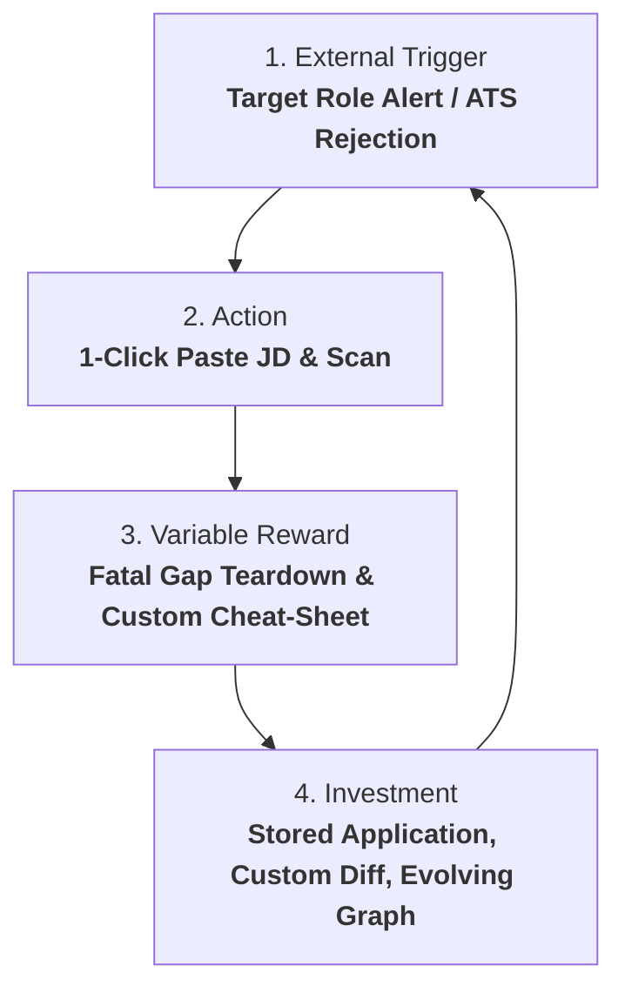

# 📡 CareerOS Retention Hook & Telemetry Specification

> **Document Status**: Production Strategy Spec  
> **Author**: Silicon Valley Head of Product & YC Advisory  
> **Frameworks Applied**: `lean-analytics-instrumenter`, `pmf-guardian`  
> **Goal**: Measure real activation & retention, eliminating vanity traffic noise  

---

## 🪝 1. THE 4-PHASE RETENTION HOOK



1. **Trigger**:
   - Immediate external trigger: Candidate finds a high-match role on LinkedIn or receives a CareerOS Market Alert.
2. **Action**:
   - 1-click paste of JD URL or description into CareerOS.
3. **Variable Reward**:
   - Unexpected insight: Discovering the non-obvious gap causing rejection (e.g., "Missing latency metrics on Kubernetes"), plus 5 customized interview questions.
4. **Investment**:
   - Candidate saves the tailored resume and notes in their CareerOS pipeline; the system learns what bullet points align with their core skills, strengthening their proprietary Career Graph.

---

## 📊 2. THE 3 NORTH STAR TELEMETRY METRICS

Vanity metrics (pageviews, visitor counts, button hovers) are strictly **banned**. We measure only 3 conversion signals:

| Metric | Target SLA | Business Meaning |
| :--- | :--- | :--- |
| **1. Activation Rate (TTV $\le 45$s)** | $> 70\%$ of visitors who start upload | User reaches the Gap Score & Fatal Flaws screen in $<45$ seconds. |
| **2. Core Value Conversion Rate** | $> 25\%$ of activated users | User approves the tailored diff and triggers export or unlocks the interview cheat-sheet. |
| **3. Sprint Cohort Return Rate (Day 7)** | $> 35\%$ of activated users | User returns within 7 days to run a 2nd target job description through the engine. |

---

## 🛠️ 3. STANDARDIZED TELEMETRY EVENT SCHEMA

Events follow the strict `noun_verb` pattern. Zero personally identifiable information (PII) is included in payloads.

```typescript
// Telemetry Event Standard (lib/telemetry.ts)
export interface CareerOSTelemetryPayload {
  eventName: 
    | 'diagnostic_started'       // Candidate submitted CV + JD
    | 'diagnostic_completed'     // Gap report generated and displayed
    | 'diff_preview_toggled'     // User inspected the line-by-line diff
    | 'tailored_resume_exported' // Value action: PDF or Markdown download
    | 'interview_sheet_viewed'   // Candidate accessed prep questions
    | 'paywall_viewed'           // Gating screen displayed
    | 'checkout_completed';      // Subscription or sprint pass purchased
  userId: string;                // Anonymized hash
  properties: {
    duration_ms?: number;
    match_score?: number;
    gaps_count?: number;
    plan_tier?: 'FREE' | 'SPRINT_PASS' | 'PRO';
  };
  timestamp: string;             // ISO 8601
}
```

---

## 🛡️ 4. PMF VELOCITY SCORECARD (SPRINT 1 AUDIT)

Per [`pmf-guardian`](file:///C:/Users/rouca/.gemini/config/skills/pmf-guardian/SKILL.md), every iteration is scored before coding:

| Dimension | Weight | Sprint 1 Wedge Score | Justification |
| :--- | :---: | :---: | :--- |
| **Customer Pain Alignment** | 30% | **28 / 30** | Solves direct ATS rejection & interview silence. |
| **Market Evidence** | 25% | **18 / 25** | Founder experience + unprompted candidate demand. |
| **Revenue Impact** | 25% | **22 / 25** | Direct paywall at point of tailored diff export. |
| **Retention Impact** | 20% | **16 / 20** | Multi-application sprint loop. |
| **TOTAL PMF IMPACT** | 100% | **84 / 100** | 🟢 **APPROVED FOR BUILD** |
