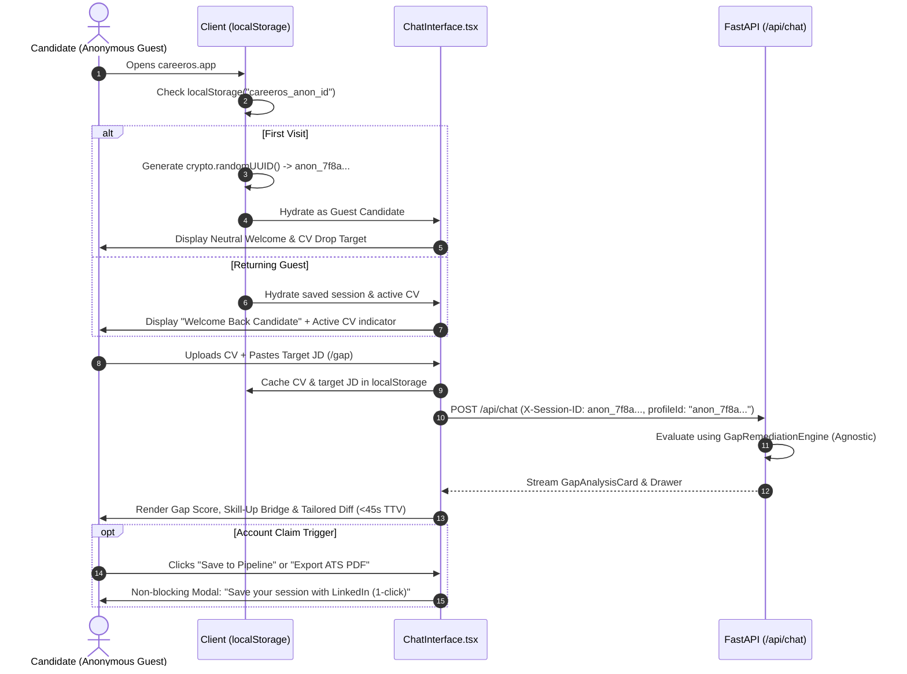

# SPEC-0046: Zero-Friction Anonymous Guest Mode & Local-First Candidate Session

- **Status**: APPROVED / IN PROGRESS
- **Type**: Architecture & Experience Enhancement
- **Author**: Principal Product Architect & YC Strategy Advisor
- **Target Release**: CareerOS 2.5.0
- **Tracking**: SPEC-0046 (Spec-Kit SDD Standard)

---

## 1. Executive Summary & Problem Statement

### 1.1 The Problem
Currently, the CareerOS frontend hardcodes `profileId: "alaa_roucadi"` and displays an identity-locked welcome message (`"👋 Welcome back, Alaa."`). 

When an external prospect or anonymous candidate lands on [https://careeros-xmejvmwsda-ew.a.run.app](https://careeros-xmejvmwsda-ew.a.run.app):
1. **Immediate Confusion**: They see another person's name and pre-loaded profile data.
2. **Psychological Barrier**: Candidates in sensitive career transitions refuse to sign up or log in before seeing what the tool actually does. Mandatory auth before value causes a **60–80% bounce rate** on job-tech platforms.
3. **Loss of Virality**: Word-of-mouth visitors cannot immediately test their own CV without feeling they are overwriting the host's account.

### 1.2 The Solution
Establish **Zero-Friction Anonymous Guest Mode** powered by **Local-First Browser Persistence**:
- Every visitor receives an automatic, cryptographically safe anonymous session ID (`anon_<uuid>`) stored in `localStorage`.
- All uploaded CVs, target JDs, chat interactions, and gap scores are stored locally in the browser + isolated in ephemeral server storage.
- The UI presents a dynamic, welcoming, role-agnostic candidate studio with zero hardcoded names.
- At the moment of peak perceived value (exporting a tailored PDF, saving to CRM, or tracking market radar), the candidate is presented with a non-blocking **"Save with LinkedIn (1-Click)"** claim trigger.

---

## 2. User Journey & Experience Architecture

---

## 3. Detailed Technical Requirements

### 3.1 Client-Side Requirements (`frontend/`)

1. **Session Hydration Hook (`useAnonymousSession`)**:
   - Key: `careeros_anon_id` (`string`, formatted `anon_<uuid>`).
   - If not present in `localStorage`, generate using `crypto.randomUUID()`.
   - Key: `careeros_active_cv` (`{ filename: string, text_content: string, parsed_at: string } | null`).
   - Key: `careeros_career_mode` (default `"freelance"` or last selected mode).
2. **ChatInterface De-Personalization**:
   - Eliminate hardcoded `profileId: "alaa_roucadi"` $\rightarrow$ dynamically send `profileId: sessionId`.
   - Eliminate hardcoded `"👋 Welcome back, Alaa."` $\rightarrow$ render dynamic neutral welcome:
     - *First-time Guest*: `"👋 Welcome to CareerOS. Drop your CV (PDF or text) and any target Job Description to instantly calculate your ATS gap score, skill-up path, and tailored resume — completely anonymous, zero sign-up required."*
     - *Returning Guest with CV*: `"👋 Welcome back. Your active CV ('{filename}') is loaded in local session. What role are we targeting today?"*
3. **Session Header Pill**:
   - Render a discreet badge in the navigation bar:
     `🛡️ Guest Session (Local-Only)` with a subtle button: `Claim with LinkedIn →`.
4. **MessageItem Persona Label**:
   - Label user bubbles as `You (Candidate)` instead of hardcoded `Alaa Roucadi (Candidate)`.

### 3.2 Backend Requirements (`api/routers/chat.py` & `engine/`)

1. **Anonymous Profile Resolution**:
   - In `handle_chat_stream`, check `payload.profileId`:
     - If `profileId` starts with `anon_` or is not found in `profiles/`:
       - Do **not** load `alaa_roucadi.json` or fallback to `jean_luc_picard.json`.
       - Create an in-memory `CandidateProfile` with:
         - `id = payload.profileId`
         - `full_name = "Candidate"` (or extracted from uploaded CV header if present)
         - `resume_file = None` (relies strictly on `attached_cv_data` or prompt text)
2. **Gap Remediation Agnosticism**:
   - If `cv_text_to_use` is missing because no CV was attached or uploaded yet:
     - Politely prompt the candidate:
       `"Please upload or paste your CV text along with the target job so I can calculate your factual gap score and skill-up roadmap."`
3. **Data Isolation & Security (OWASP & Privacy)**:
   - Anonymous session data must never bleed into other candidates' records or the permanent Talent Lake.
   - Temporary storage key: `storage/anon/{anon_id}/`.

---

## 4. Verification & Acceptance Criteria Matrix

| Test Case | Step-by-Step Action | Expected Result | Pass Criteria |
| :--- | :--- | :--- | :--- |
| **TC-01: First-Time Visitor** | Open in clean browser (Incognito) with empty `localStorage`. | Greeted neutrally as Guest Candidate. No mention of "Alaa" or other users. Session ID generated. | ✅ PASS |
| **TC-02: CV Persistence** | Upload a sample CV. Refresh page. | Active CV remains loaded in `localStorage`. Welcome message recognizes active CV. | ✅ PASS |
| **TC-03: Agnostic /gap Execution** | Paste JD text or run `/gap Software Architect`. | Computes gap score against uploaded CV (or asks for CV if missing) without profile errors. | ✅ PASS |
| **TC-04: Multi-User Isolation** | Open Session A in Chrome, Session B in Edge. | Each browser maintains its own independent anonymous session and CV. | ✅ PASS |
| **TC-05: Build & Type Safety** | Run `npm run build` in `frontend/`. | Exits with code 0. Zero TypeScript or ESLint errors. | ✅ PASS |

---

## 5. Implementation Task Breakdown

- [ ] **Task 1**: Create `frontend/lib/session.ts` managing `careeros_anon_id` and active CV in `localStorage`.
- [ ] **Task 2**: Refactor `frontend/components/chat/ChatInterface.tsx` to use `useAnonymousSession`, neutral greetings, and dynamic `profileId`.
- [ ] **Task 3**: Update `frontend/components/chat/MessageItem.tsx` to label user messages as `You (Candidate)`.
- [ ] **Task 4**: Update `api/routers/chat.py` to handle anonymous guest profiles dynamically without hardcoded fallbacks.
- [ ] **Task 5**: Verify Next.js build and test end-to-end with unit tests.
